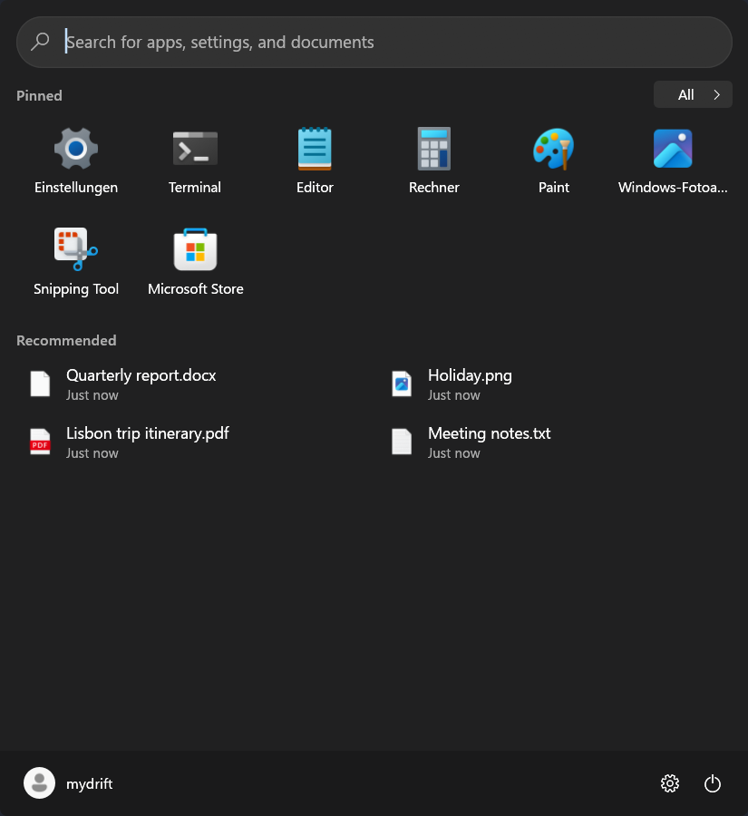
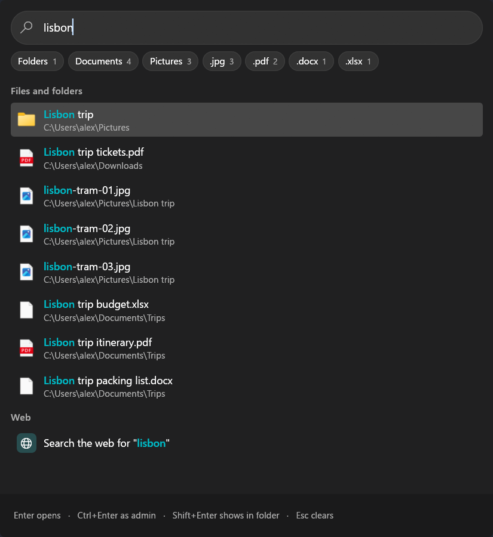

<div align="center">


# Startline

**A Start menu for Windows that's yours to arrange, with search that answers as you type.**

Native, written in Rust, with no web view and no runtime to install.

[](https://github.com/MyDrift-user/startline/actions/workflows/ci.yml)


&nbsp;

</div>

---

## ✨ Features

### 🪟 Takes over the Start key
While Startline runs, the Start key and the Start button open it instead of the Windows menu. **Shift + Start** still opens the Windows one, and quitting Startline from its tray icon gives everything back.

### ⚡ Search as you type
- Apps and settings are answered in the same frame as the key press
- Files come from an index that keeps every name in one block of memory, so a million files is one fast scan. It's saved to disk, so search works from the first moment, and kept fresh by watching for changes instead of reading every drive again at each start
- Filter chips for folders, documents, pictures and each file type in the results, with the time the search took
- A search language: `"exact text"`, wildcards (`*.pdf`, `img_??.png`), `-word` to leave out, `ext:pdf,docx`, `kind:picture`, `size:>10mb`, `modified:today` or `date:2025-03`, and regular expressions with `re:` or `/…/`, or a switch that makes the whole search one. The `?` in the search box lists it all
- Choose where to search, with a switch each for the PC's own drives, network drives and USB drives, and what's never found: ready-made groups, hidden and system files, folders, file types and regular expressions
- Choose which kinds of results show, in which order and how many of each, and hide the parts of the search box you don't use
- A Best match at the top: the one result whose name fits what you typed best, whatever its kind, so Enter opens the folder or file you named even when apps come first
- A web search for what you typed, in your default browser with the search engine you set up there, or at a fixed address if you'd rather
- New apps show up in the list and search within seconds of being installed, and removed ones go

### 🎚️ Settings right in the search
Type what you want and act on it from the result: "dark mode", "volume 40", "louder", "bluetooth off", "wlan aus". There are dozens of switches and sliders, from dark mode, Wi-Fi, Bluetooth, do not disturb, mute, volume and brightness to file extensions, hidden files, the clock's seconds, Game Mode and keeping the PC awake, each showing how it's set now. "audio output" or a device's name switches the sound to another output. Nothing changes until you act on the row.

### 🧮 Quick actions
Each one has its own switch under **Settings > Search > Quick actions**:
- **Calculator** (off at first): sums like `12 * (3 + 4)` or `15% of 80`, conversions of length, weight, temperature, volume, data sizes and time like `5 km in mi`, `70 f to c` or `2 gib in mb`, and dates like `today + 30 days`. No currencies, nothing online. Enter copies the result
- **Clipboard history** (off at first): what you copied, found by its words from three letters on, from Windows's own clipboard history when it's switched on in Windows. Enter copies it again. Start a search with "clipboard" to see more of it
- **Windows settings** and their pages by name in your language, and **power actions**: lock, sleep, sign out, restart and shut down, where restart and shut down ask you to press again. These were in search before and stay on

### 🔖 Bookmarks
Off until you turn it on under **Settings > Search > Bookmarks**. Then search also finds:
- Your browsers' bookmarks, from every profile of Chrome, Edge, Brave, Vivaldi, Opera, Helium and other Chromium browsers, and Firefox. They're only ever read, never written, read again when they change, and open in the browser and profile they came from. Choose which browsers and profiles count
- Your own bookmarks: web addresses, files, folders and commands, in folders, added in Settings or with **Add to bookmarks** on a result's right-click menu, where you can also change or remove them
- Bookmarks your organization adds with the Bookmarks policy, shown to you but not removable

Bookmarks take part in the Best match.

### 🎵 Now playing
On at first, under **Settings > Start menu**, where the cover can be switched off too. A small card above the footer (under the tiles in the Windows 10 look) with what's playing: cover, title, artist and app, play or pause, previous and next, and a button to switch between apps when several play. It uses Windows's own media controls, the ones the volume flyout shows, so Spotify, browsers and any player that tells Windows work without keys or signing in. It's out of sight when nothing plays.

### 📅 Microsoft 365, if you want it
Off until you turn it on. Sign in with a work or school account on the **Microsoft 365** page of Settings, through Windows's own account sign-in, and switch on what you'd like:
- **Calendar** beside the menu in the Windows 11 and Startline looks: today's timeline with the time now, all-day events on top, the day before and after, **Join** for online meetings, Accept, Tentative and Decline for invitations, and new events. The last copy shows at once and offline
- **People** in search: colleagues from your organization, with Enter starting a Teams chat and buttons to call or mail them
- **Mail** in search, by subject, opening in Outlook on the web

Startline asks Microsoft only for what's switched on, keeps only which account it is (Windows keeps the sign-in), and talks to nothing but Microsoft's sign-in and Microsoft Graph. Signing out forgets all of it.

### 🎨 Make it yours
- Five looks: Windows 11, Windows 10, Windows 7, Windows XP, or Startline's own, which you can place anywhere on screen
- Presets that set a look in one go: like Windows 11 Start, Startline's own, or compact. Each setting stays yours to change afterwards
- Mica behind the menu on Windows 11 (22H2 and later), with a lighter Mica through the search box and the selected item if you like
- English, German and Italian, following the language Windows is shown in, or chosen in Settings
- Colour presets (Stone, Graphite, Moss, Harbor, Clay, Black, Daylight and Paper), your own colours, or, from the start, a theme that follows Windows' light or dark mode with a light and a dark preset you pick
- Pin apps, files, folders, web addresses and programs with arguments, in the order you like
- Choose which sections the menu shows (Pinned, Recent files, Most used, All apps) and how many
- Size, position, corners and transparency
- Start with Windows, on by default

### 🏢 Ready for IT departments
Every setting can be fixed, or given as a default people can change, by **Group Policy** or straight in the Registry (`Software\Policies\Startline` and its `Recommended` subkey, under HKLM or HKCU), for computers or users. ADMX templates come with ADML in English, German and Italian. Pins and their sections, the layout and size, what the menu shows, how search behaves and whether updates install by themselves can all be deployed this way, without copying `start2.bin` around. Fixed settings show greyed out with "Managed by your organization", and running copies pick up changes within a minute. [`PolicyDefinitions/README.txt`](PolicyDefinitions/README.txt) lists every value.

**What it reads from disks.** Startline reads only the names, sizes and dates of files and folders, never what's in them. Out of the box it indexes the PC's own drives; network and USB drives are off. Reading runs in Windows's background mode, one folder at a time on hard disks, and waits while a full-screen app is in front and for the first ten minutes on battery. Disks in a USB enclosure count as USB drives. After the first run it trusts its saved index and Windows's change notices, and reads a drive again only when the search places change, Windows loses track, or the index is more than a day old. Network shares, when switched on, are read at most once a day while the PC is idle, at most 20 folders a second, with no watch on the server. The policies **SearchLocalDrives**, **SearchNetworkDrives** and **SearchUsbDrives** turn each kind on or off.

**Microsoft 365 for admins.** The account and each part have a policy: **M365Account**, **M365Calendar**, **M365People** and **M365Mail**, all off unless set. Startline asks for the delegated Graph permissions User.Read, plus User.ReadBasic.All for people, Calendars.ReadWrite for the calendar and Mail.ReadBasic for mail, only for what's on.
- *Approving Startline.* Where people may not approve apps themselves, Startline tells them so and copies a link for you. As an administrator, open `https://login.microsoftonline.com/<tenant>/adminconsent?client_id=<client ID>`, or approve Startline under Enterprise applications in the Entra admin center.
- *Your own app registration.* Register a single-tenant public client in Entra ID: Mobile and desktop applications, with the redirect URIs `http://localhost` and `ms-appx-web://Microsoft.AAD.BrokerPlugin/<client ID>`, "Allow public client flows" on, and the four delegated permissions above. Give Startline its application (client) ID, and your tenant's ID or domain so only your accounts can sign in, in any of the three ways below.

*Where the app registration comes from.* The ID is never in the source, and all three ways are optional. Where more than one is set, **Group Policy wins, then the installer, then the build**, for the client ID and the tenant each on its own. The Microsoft 365 page of Settings says which one is in use ("Set by your organization", "Set by the installer", "Built in"), and shows "Not available in this build" only when none is set. `startline.exe --m365-source` prints the same.
1. **Group Policy**: **M365ClientId** and **M365TenantId**, fixed or as defaults, under Startline > Microsoft 365.
2. **When installing**, for this PC or one account:
   ```bat
   msiexec /i startline-v0.0.2-windows-x64.msi /qn ALLUSERS=1 M365CLIENTID=<client ID> M365TENANTID=<tenant>
   startline-v0.0.2-windows-x64-setup.exe /VERYSILENT /ALLUSERS /M365CLIENTID=<client ID> /M365TENANTID=<tenant>
   ```
   They're written to Startline's own key, `HKLM\Software\Startline` for this PC or `HKCU\Software\Startline` for one account (values `M365ClientId` and `M365TenantId`). An upgrade that doesn't give them again keeps them, and uninstalling removes them.
3. **When building**: set `STARTLINE_M365_CLIENT_ID` and `STARTLINE_M365_TENANT_ID` before `cargo build`, or build ready installers with your own registration:
   ```powershell
   installer\windows\package.ps1 -M365ClientId <client ID> -M365TenantId <tenant>
   ```
   The release workflow builds them in from the repository variables `STARTLINE_M365_CLIENT_ID` and `STARTLINE_M365_TENANT_ID` when they're set, and without them when they're not.

## ⌨️ Keyboard

| Keys | Action |
|---|---|
| `Start` | Open or close Startline |
| `Shift + Start` | The Windows Start menu |
| Just type | Search right away |
| `Enter` | Open, or apply a setting |
| `Ctrl + Enter` | Run as administrator |
| `Shift + Enter` | Show in its folder |
| `Down`, then `Left` and `Right` | Change a selected setting |
| `.pdf` | Only one kind of file |
| `Esc` | Clear, go back, then close |

---

## 📦 Install

Download what you need from **[Releases](../../releases)**, for Windows 10 or 11 (x64):

| File | What it is |
|---|---|
| `startline-v<version>-windows-x64-setup.exe` | Installer, for this PC or just your account |
| `startline-v<version>-windows-x64.msi` | MSI installer with a setup wizard, or silent for managed deployment |
| `startline-v<version>-windows-x64-portable.exe` | Portable, runs without installing |
| `startline-v<version>-windows-x64.zip` | The same portable program, zipped |
| `startline-v<version>-policy-definitions.zip` | Group Policy templates |

Both installers can install for this PC or for just your account. To install without any screens, here for version 0.0.2:

```bat
:: For this PC, from an administrator prompt. The folder is optional.
msiexec /i startline-v0.0.2-windows-x64.msi /qn ALLUSERS=1 APPLICATIONFOLDER="D:\Apps\Startline"
startline-v0.0.2-windows-x64-setup.exe /VERYSILENT /ALLUSERS /DIR="D:\Apps\Startline"

:: For one account, without admin rights.
msiexec /i startline-v0.0.2-windows-x64.msi /qn ALLUSERS=2 MSIINSTALLPERUSER=1
startline-v0.0.2-windows-x64-setup.exe /VERYSILENT /CURRENTUSER
```

Nothing is signed by a known publisher, so SmartScreen may show a warning. Uninstalling closes Startline and removes its Start with Windows entry.

## 🔄 Updates

Startline looks for a new release 90 seconds after it starts and every 6 hours, and installs it by itself unless you turn that off under **Settings > About & updates**, which also shows the version and lets you check by hand. As Startline is always running, it closes and starts again with the new version, only while neither the menu nor the settings window is open:

| Installed as | How updates land |
|---|---|
| For one account (MSI or `setup.exe`) | Installed silently, then Startline starts again |
| For this PC (MSI or `setup.exe`) | A scheduled task, `Startline Updater`, installs it as SYSTEM within the hour and starts Startline again for everyone who had it running. No admin prompts. The install folder is locked so only administrators can change it |
| Portable | Replaces its own file and starts the new one |

Every release lists its files' checksums in `latest.json`, signed in `latest.json.sig`. Startline checks that signature against a key built into it, and refuses anything that doesn't match. Administrators can fix automatic updates on or off with the **AutomaticUpdates** policy, or stop Startline looking for updates at all with **CheckForUpdates**. `startline.exe --update-now` does an update check from a script, and what happened is logged to `update.log` in the settings folder.

## ⚙️ Settings and data

Settings, the app list, the search index and the update log are in `%LOCALAPPDATA%\Startline\`. Settings are a JSON file, `config.json`, and survive updates.

## 🛠️ Build from source

You need [Rust](https://rustup.rs).

```sh
cargo build --release
```

The program ends up in `target/release/startline.exe`. Its icon and version need a resource compiler: `rc.exe` from the Windows SDK with MSVC, or `windres` (in MSYS2) on the PATH with the GNU toolchain. With the `x86_64-pc-windows-gnu` toolchain, the `windows` crate needs a working `dlltool`, for example MSYS2's, set with `-C dlltool=...` in `.cargo/config.toml`. The MSVC toolchain needs nothing extra.

`assets/make-assets.ps1` draws the logo, the icon and the installer's pictures from the same shape as the app's icon.

## 🚀 Releasing

Every push is built and tested by the CI workflow, which also checks that `PolicyDefinitions` matches what the program writes with `startline.exe --write-policy-templates PolicyDefinitions`. Releases only start by hand:

1. Raise `version` in `Cargo.toml`, add a `## <version>` section to [`CHANGELOG.md`](CHANGELOG.md) saying what changed for people, and push. A version can't change once it's released, because updates go by the number. The section becomes the release notes, and the workflow stops before building when it's missing.
2. Go to **Actions > Release > Run workflow**. Turning off **Publish** only builds and tests, leaving the files on the run.

Publishing waits for an approval on GitHub, as the signing key is a secret of the protected `release` environment. If that key is lost or leaks, a release signed with the offline backup key can still reach every copy, and replace it.

The workflow builds and tests the program, builds every download, checks that both installers install and uninstall (for this PC, for one account and into a chosen folder) and that the MSI upgrades the published release. It then updates every kind of install from this version to a newer test build, through the real installers and the real SYSTEM task, signed with a throwaway key, and checks that bad signatures, changed files and the update policies stop it. Last, it signs the update list, checks the program accepts it, tags `v<version>` and publishes a GitHub Release.

## 🗺️ Project layout

```
src/
  main.rs                 entry point and the app's icon
  ui.rs, popup.rs         the window and how it opens and closes
  home.rs, classic.rs     the Start menu, in Startline's look and the older Windows looks
  search.rs, search_page.rs, matching.rs   search and its results
  index.rs, scope.rs      the file index and where it looks
  apps.rs, icons.rs       installed apps and their icons
  intent.rs, settings.rs, actions.rs   settings you can change from a search
  providers.rs, quick.rs, calc.rs   where results come from, and the quick actions: calculator, clipboard, sound outputs
  bookmarks.rs, bookmarks_page.rs, favicons.rs, sqlite.rs   bookmarks: the browsers' (Firefox's through Windows's own SQLite) with their sites' icons, and your own
  media.rs, now_playing.rs   what's playing, through Windows's media controls, and its card
  mica.rs                 Mica, painted from the desktop picture
  system.rs, platform.rs  the Start key, tray icon and Windows calls
  customize.rs, pins_page.rs, setting_list.rs, widgets.rs, styles.rs   Settings and the looks
  config.rs               what's saved
  i18n/                   English, German and Italian, with the house style and glossary in its README
  policy*.rs              Group Policy: the list, reading it, the templates and admin guide, and their tests
  update.rs               signed updates from GitHub releases
build.rs                  puts the icon and version into startline.exe
PolicyDefinitions/        ADMX / ADML templates
assets/                   logo, icon, screenshots and the script that draws them
installer/windows/        setup.exe (Inno Setup) and MSI (WiX) definitions, packaging, and the installer and update tests
```

## 📄 License

Copyright (C) 2026 MyDrift. Startline is free software, released under the [GNU General Public License v3.0](LICENSE).

---

<div align="center">
<sub>Made with 🦀 Rust and <a href="https://github.com/emilk/egui">egui</a>.</sub>
</div>
